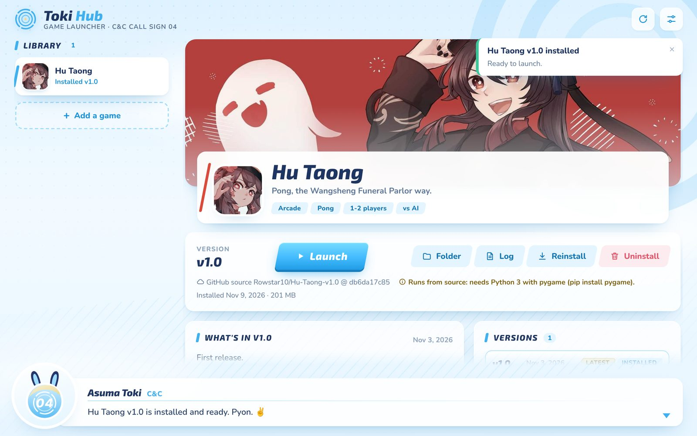

# Toki Hub

A launcher for all my games and every version of them.



## Download

Get **Toki Hub.exe** from the [latest release](https://github.com/Rowstar10/Toki-Hub/releases/latest) and
double-click it. Nothing to install.

Windows may say it "protected your PC", because the exe isn't code-signed. Click **More info**, then
**Run anyway**.

On an Android phone or tablet, get **Toki-Hub-android.apk** from the same release and open it. There,
games install as apps: the hub downloads each one and Android asks you to install it.

## Setup

Nothing to set up. This repository and the game repositories are public, so the hub downloads games
and its own updates without a token (games come from GitHub's ordinary download links).

A [fine-grained GitHub token](https://github.com/settings/personal-access-tokens/new) (Settings, top
right) is only needed for games in private repositories: give it read-only **Contents** access to them.

## What it does

- **Installs games with everything they need.** Python games get the Python version and packages their
  catalog entry lists, installed just for that game: nothing system-wide, no admin rights.
- **Shows game updates.** When a newer version of an installed game is out, its card in the library gets a
  gold **Update** badge and its page a gold **Update** button. That installs the new version and removes
  the one it replaces; other versions you kept stay. (On Android each version is its own app, so the old
  one stays until you uninstall it.)
- **Updates itself.** When a new version is out, a gold **Update** button appears at the top.
  Settings › Updates has **Check now**.
- Settings and installed games are in `%LOCALAPPDATA%\Toki Hub`.

## Adding games and versions

Each game is a folder in [`catalog/`](catalog) with a `game.json`. [catalog/README.md](catalog/README.md)
explains the format and has copy-paste examples. Games added there are built into the next release.

To add a game without making a release, put its folder in `%LOCALAPPDATA%\Toki Hub\catalog` and
press the reload button in the hub.

## Releasing a new version

Change `version` in [`src-tauri/Cargo.toml`](src-tauri/Cargo.toml) and push. GitHub builds Toki Hub.exe
and Toki-Hub-android.apk, publishes them as a release, and running copies offer the update. The APK
is signed with the `ANDROID_KEYSTORE` and `ANDROID_KEYSTORE_PASSWORD` secrets (the same key every
time, or phones can't update).

## Building it yourself

Needs [Rust](https://rustup.rs) and [Node.js](https://nodejs.org):

```bash
npm ci
npm run build
```

The exe is `target/release/toki-hub.exe`. For Android (also needs the Android SDK and NDK):
`npx tauri android build --apk`. Tests:

```bash
cargo test -p toki-hub-core
```
